# One phone video → many robot demos

The challenge was to use real data I collected myself to drive a robot arm in simulation. I filmed myself
picking up a cube and placing it on a target with my iPhone, turned my hand's motion into a 3D trajectory in
metres, and used it to drive a simulated Franka Panda in robosuite. Then I re-attached that motion to the
objects (the idea behind MimicGen), so one recording works for cube and target positions I never demonstrated,
and trained a small policy on the demos it generates.

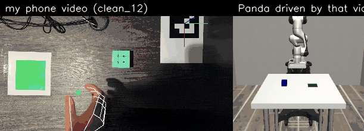

*Left: my phone video, with the tracked hand, the pinch point (green open, red holding) and the table frame from
the marker. Right: the simulated Panda following the trajectory extracted from that video.*

| Replaying my recorded path after the cube moved | Re-attaching it to the objects (same scene) |
|---|---|
| 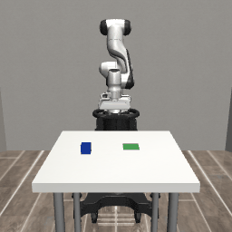 |  |

## Results at a glance

All from one recorded demo (`clean_12`), tested on 50 random cube and target positions:

| | Success |
|---|---|
| Replaying my recorded path as it is | 2/50 (4%) |
| Re-attaching it to the objects (object-relative) | **50/50** |
| Object-relative, objects moved up to ±15 × ±12 cm / ±25 × ±20 cm | 50/50 / 50/50 |
| Object-relative, with a 1 cm error in where it thinks the objects are | 50/50 (64% at 2 cm, 8% at 3 cm) |
| Cube moved 5 cm halfway through the approach: open-loop replay / re-planning / BC policy | 0/50 / 50/50 / 50/50 |

## Quickstart

The processed data, trajectories and trained policies are in the repo, so the main results reproduce without any
video. About 5 minutes on a laptop CPU:

```bash
python3.12 -m venv .venv && source .venv/bin/activate
pip install -r requirements.txt
python scripts/evaluate_generalisation.py clean_12      # raw 2/50 vs object-relative 50/50
python scripts/evaluate_policy.py clean_12 --ensemble   # BC policy 50/50
python scripts/evaluate_nudge.py clean_12               # nudge: open loop 0/50, re-planned 50/50, BC 50/50
```

## The idea

A video of a person shows what to do, but not in a form a robot can use: there's no depth, the grasp is a human
hand, and it only shows one scene. So I did three things:

1. Measured my demo in metres from a single phone camera, using a printed ArUco marker to define the table and
   the cube's known size as a depth reference.
2. Replayed it on a simulated robot, with the cube and target where they were when I recorded it.
3. Generalised it: split the motion at the grasp and the release, and re-attached each part to the object it
   belongs to, so the same demo works wherever the cube and target are.

## Pipeline

```
iPhone video (1080p, 60 fps, filmed from above)
  │  extract_2d.py              MediaPipe hand landmarks, ArUco marker, cube/target colour masks   (pixels)
  │  calibrate_camera.py        camera matrix + lens distortion (checkerboard)
  │  detect_events.py           when the cube was picked up and put down
  │  build_trajectory.py        table frame, positions on the table, hand depth, per-demo scale     (metres)
  ▼
pinch trajectory + gripper open/closed + where the cube and target were
  │  replay_in_sim.py            map onto the sim table, follow at 20 Hz, contact fixes
  │  evaluate_generalisation.py  raw vs object-relative replay on random scenes, error budget
  │  generate_dataset.py         300 object-relative rollouts → training data
  │  train_bc.py                 behaviour-cloning policy (3 seeds)
  │  evaluate_policy.py / evaluate_nudge.py
  ▼
robosuite Panda. Success = cube lifted more than 5 cm AND its centre resting inside the 10 cm target
```

## Setup and data

- **Camera:** iPhone 13 Pro Max, 1× lens, 1080p at 60 fps, HDR and stabilisation off, focus and exposure locked
  on the table. Overhead, about 74 cm above the table.
- **Scene:** a Rubik's cube (5.7 cm, light-blue face up), a 10 × 10 cm green target, and a 10 cm ArUco marker
  (DICT_4X4_50, ID 0) in one corner.
- **Grasp:** thumb and index on opposite sides of the cube, at mid-height. That keeps the top face visible for
  tracking, matches the Panda's parallel-jaw gripper, and means the pinch point is at a known height (the cube's
  centre, 2.85 cm) at the moment I grab it.
- **Recordings:** 12 clean demos, 5 messy ones (hesitation, a pause in mid-air, a re-grasp, an overshoot, uneven
  speed), 1 rotation clip, a calibration video and a depth-check clip. The raw videos aren't in the repo because
  of their size; the per-frame detections and trajectories are.

## Perception

### Camera calibration
OpenCV checkerboard calibration (10 × 7 squares, 25 mm). My first three attempts, holding or propping the board,
gave 1.3–1.6 px error and a focal length that wandered between 1660 and 1854 px. Keeping only frames where the
board was completely still didn't help, so the problem was that the board wasn't flat. Laying it flat on the
table and moving the phone instead gave 0.46 px over 39 views. I used a constrained model (square pixels,
principal point at the centre, no tangential distortion), because a phone already corrects most of its lens
distortion. The focal length (1655.5 px) matches an earlier, independent video to within 0.3%.

### Table frame
I estimate the marker's pose (its position and orientation) once per clip, from the median of its detected
corners. The camera doesn't move during a clip, and the median ignores frames where the marker is missed. Square
markers can have an ambiguous tilt, so I checked both solutions: the chosen one fits the corners to 0.05–0.33 px,
the other to 4.1–4.4 px.

As a check, the 10 cm target square measures 9.6–10.0 cm through this frame in every clip.

### Positions on the table
Everything I need to locate lies on a plane of known height, so I intersect each pixel's ray with that plane:
z = 0 for the target, z = 5.7 cm for the top of the cube. The height matters. The cube's top face covered 20,158
pixels, against about 16,000 expected at table level, because it's 5.7 cm closer to the camera.

### When the cube was picked up and put down
A pinch on a 5.7 cm cube never closes, and the fingertips are often hidden, so I use the cube instead. When it's
carried, its centre moves; when it's lifted, its top face looks bigger, because it gets closer to the overhead
camera. My hand or its shadow makes the top face look smaller, so I treat shrinking as something covering it,
not as movement. The grasp is the end of the cube's last rest on the table before the release, which handles
re-grasps. Then I refine both moments to the lowest point of my pinch, since that's where contact happens.

### Depth of the hand from one camera
I compared two methods on a clip where I held the pinch at known heights:

| Method | Average error | Two holds at the same spot | Hand held upright |
|---|---|---|---|
| Hand length (wrist to middle knuckle: depth = focal length × length / pixels) | −15.5 cm | 0.9 cm apart | +6.4 cm |
| solvePnP on MediaPipe's 3D hand landmarks | +0.5 cm | 4.4 cm apart | +17.7 cm |

I went with hand length. Its error is big, but it's the same every time: my ruler measurement of my hand doesn't
match where MediaPipe puts its landmarks, which is a scale error, and one known height corrects it. solvePnP is
right on average, but two identical holds came out 4.4 cm apart, and nothing calibrates that away.

The correction uses the cube. In every demo my pinch is at the cube's centre height (2.85 cm) when I grab it and
again when I let go. Using only the grab left the release off by +1.3 ± 3.8 cm (up to +7.9 cm), because I hold my
hand differently when placing than when grasping. So I fix the scale at both moments and blend between them.
Across demos the scale at the grasp was 0.796 ± 0.039, which matches the ~0.80 from the separate depth-check clip.
Impossible points (a height below −3 cm or above 45 cm, or a jump of more than 5 cm between frames) are dropped
and filled in.

## Simulation

- **Scene:** robosuite 1.5.2. A subclass of `Lift` with a 5.7 cm cube (fixed orientation) and a 10 cm target that
  the cube can't collide with. The arm is controlled with OSC delta actions at 20 Hz, gripper pointing down.
- **Mapping:** I rotate the recorded scene about the vertical axis so the carry runs left to right in front of the
  robot, and centre it on the table. Distances and heights stay the same.
- **Tracking:** a proportional controller follows the trajectory; the gripper closes and opens when I did.
- **Contact fixes:** near the cube and the target, the path stays 3 cm above the cube's top, except for a final
  straight-down descent, and goes straight up after each contact. The robot's gripper is wider than my pinch, and
  the depth estimate is least reliable near contact. I report results without the fixes too.
- **Success:** the cube was lifted more than 5 cm, and its centre ends up inside the target square. With the
  stricter rule (the whole cube inside), at least 247 of the 250 successful placements in the main experiments
  still pass.

## Object-relative generation

I split the demo at the grasp and the release:

- **Approach** (start to grasp) belongs to the cube: it moves by however far the cube moved.
- **Carry** (grasp to release) hands over from the cube to the target, with a smooth blend so there are no jumps.
- **Place and retreat** (release to end) belong to the target.

Because the grasp is always top-down and the cube's orientation is fixed, MimicGen's pose transforms
(T_new · T_old⁻¹) come down to translations. The whole thing is about ten lines in
[`src/sim/generator.py`](src/sim/generator.py).

## Results

Every replay uses seeded trials (robosuite starts the arm in a slightly different configuration on each reset),
and every method is tested on the same fixed-seed scenes, so reruns reproduce exactly.

### Replay at the recorded positions (7 demos × 5 seeds)

| Demo | Raw replay | With contact fixes | Notes |
|---|---|---|---|
| clean_1 | 0/5 | 0/5 | longest carry (42 cm) |
| clean_3 | 1/5 | 5/5 | |
| clean_8 | 0/5 | 0/5 | tracked grasp point 5 cm off the cube's centre |
| clean_11 | 5/5 | 5/5 | |
| clean_12 | 5/5 | 5/5 | the source demo for everything below |
| messy_4 | 5/5 | 5/5 | |
| messy_5 | 5/5 | 5/5 | |
| **Total** | 21/35 (60%) | **25/35 (71%)** | |

### One demo, new positions (clean_12, 50 random scenes per run)

| Method | How far the cube and target can move | Success | Cube lifted | Distance to target centre |
|---|---|---|---|---|
| Raw replay | ±8 × ±6 cm | 2/50 | 6/50 | 28.5 cm |
| Object-relative | ±8 × ±6 cm | **50/50** | 50/50 | 1.3 cm |
| Object-relative | ±15 × ±12 cm | **50/50** | 50/50 | 1.4 cm |
| Object-relative | ±25 × ±20 cm | **50/50** | 50/50 | 1.5 cm |

By how far the cube moved from where I recorded it:

| Cube moved | Raw replay | Object-relative (±15 cm) | Object-relative (±25 cm) |
|---|---|---|---|
| 0–4 cm | 1/14 | 4/4 | — |
| 4–8 cm | 1/29 | 11/11 | 6/6 |
| 8–12 cm | 0/7 | 16/16 | 6/6 |
| 12–16 cm | — | 14/14 | 10/10 |
| 16–25 cm | — | 5/5 | 20/20 |
| 25–40 cm | — | — | 8/8 |

Raw replay only lifted the cube when it had moved less than 4.1 cm, and only placed it when the target had also
barely moved. Object-relative replay never failed in the range I tested. The Panda can reach the whole sim table,
so reach wasn't the limit.

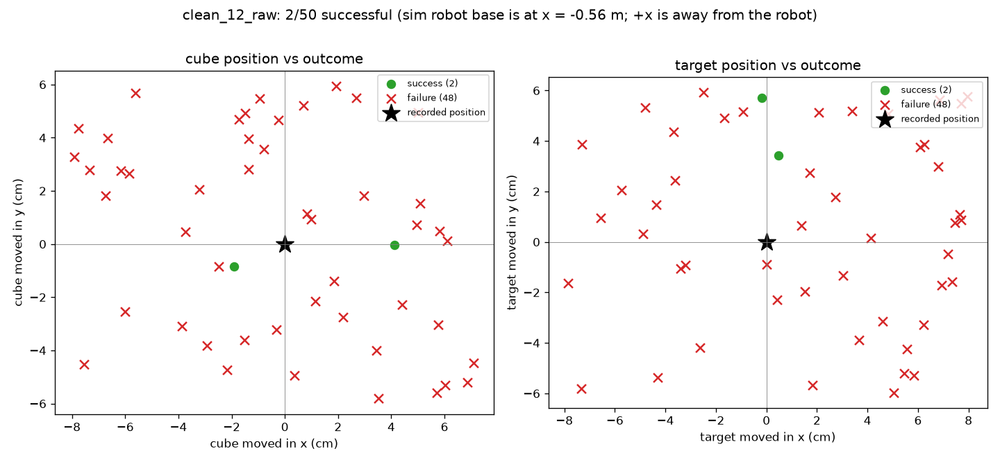
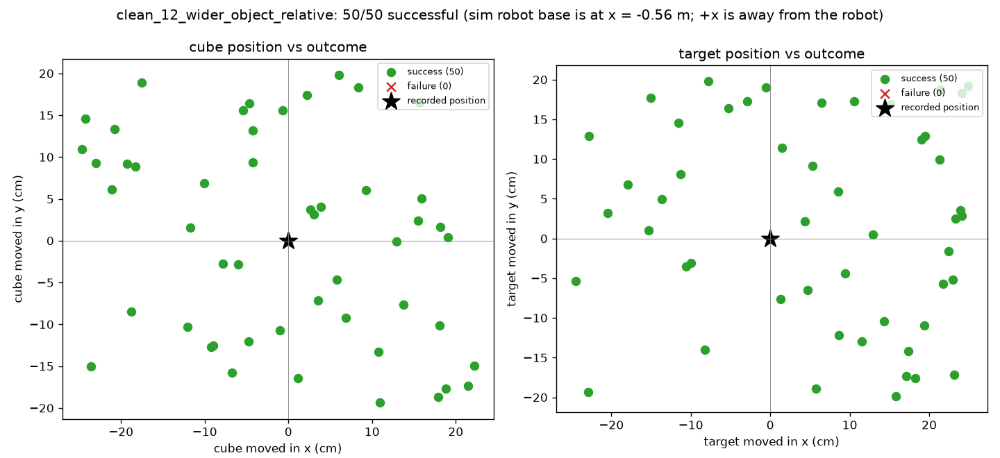

Object-relative replay with the cube and target moved up to ±25 × ±20 cm:

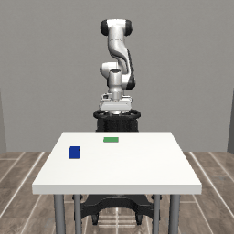

### Error budget: how accurately does it need to know where things are?

In sim, the generator knows exactly where the cube and target are. A real robot would get those positions from a
camera, with some error. So I told the generator positions that were off by a set distance in a random direction,
while the real objects stayed put (50 scenes per level):

| Position error | 0–1.0 cm | 1.5 cm | 2.0 cm | 3.0 cm | 4.0 cm | 5.0 cm |
|---|---|---|---|---|---|---|
| Success | 100% | 80% | 64% | 8% | 4% | 0% |

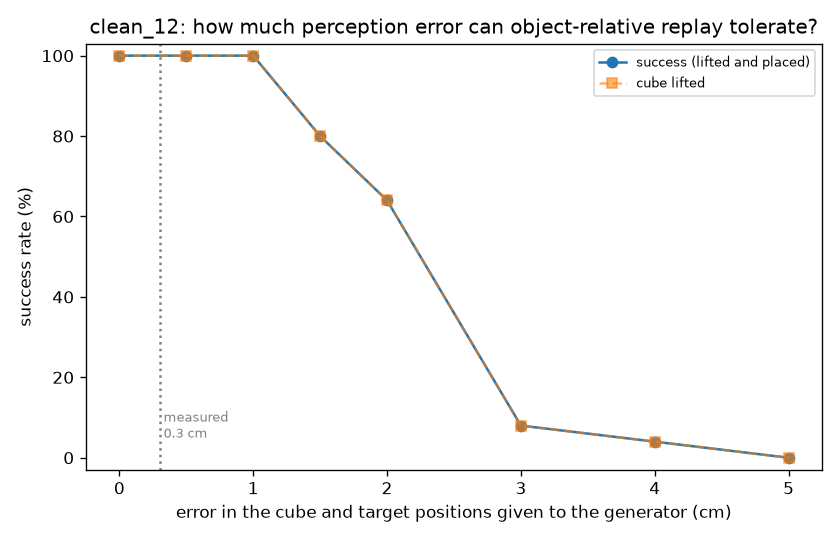

Every failure here is a missed grasp; once the cube is held, the placement always works. The drop between 1 and
3 cm fits the gripper: about 8 cm of opening around a 5.7 cm cube leaves about 1.1 cm of slack on each side. My
table frame is accurate to about 0.3 cm (from the target-size check), so there's a 3× margin before the first
failure. I didn't measure the accuracy of the cube's detected position separately.

This is also why the approach works with a phone. The weakest part of my perception is the hand's depth, but the
generator re-attaches every contact to the objects, and the object positions come from ray–plane intersection on
known heights, which is the most accurate part of the pipeline.

### Behaviour cloning

A replayed path is open loop: if the cube moves during the episode, the robot carries on to where it used to be.
A policy is closed loop: at every step it looks at where things are now and decides what to do.

- **Data:** 300 object-relative rollouts from my one demo, with the cube and target moved up to ±15 × ±12 cm.
  I generated one dataset per way of labelling the gripper (below): 300/300 rollouts succeeded with the first (55,863 steps), 299/300 with the second. While collecting, the robot executed the expert's action plus a little random
  noise, but I saved the clean action, so the data includes examples of getting back on track (DART).
- **Inputs (11 numbers):** gripper to cube, gripper to target, cube to target (3 each), finger opening, gripper
  height. Relative vectors turn the task into "move towards the thing", wherever the thing is.
- **Outputs:** x/y/z movement, and gripper open or closed.
- **Model:** an MLP with two layers of 256, trained on 240 episodes and validated on 60, with 3 seeds.

| How the expert labelled the gripper | Seed 0 | Seed 1 | Seed 2 | Mean ± std | 3 seeds averaged |
|---|---|---|---|---|---|
| Close at a fixed time step | 90% | 64% | 100% | 84.7% ± 15.2% | **100%** |
| Close when the gripper reaches the cube | 46% | 100% | 96% | 80.7% ± 24.6% | **100%** |

(50 test scenes, closed loop.)

Every failure of a single policy looked the same: the gripper came down over the cube and hovered there without
closing. None failed after lifting. My first guess was the labels. The first expert closed the gripper at a fixed
time, when the robot was still 2.4–3.4 cm above the cube's centre, so near-identical states were labelled both
"open" and "close". Switching to closing at the cube (0.1–0.7 cm) fixed the labels, but not the problem. With the noise, the gripper didn’t reach the contact point within 2 s at 89 of 598 contacts, so those still switched on time
What did fix it: each seed hovers in different scenes, so averaging the three policies' outputs gets 100% with either expert.

### Nudge experiment

Here the cube jumps 5 cm in a random direction halfway through the approach. Every method gets the same nudge, on
the same 50 scenes:

| Method | Success |
|---|---|
| Object-relative replay, open loop (path for the original position) | 0/50 |
| Re-planned (rest of the path regenerated when told the cube moved) | 50/50 |
| BC policy, 3 seeds averaged | 50/50 |

| Open loop | Re-planned | BC policy |
|---|---|---|
| 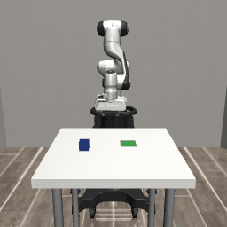 |  | 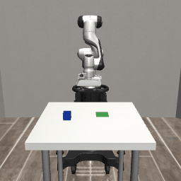 |

*The same scene and the same nudge for all three.*

Open-loop replay fails every time, which is what the error budget predicts for a 5 cm error. Re-planning and the
policy both recover in every scene. The difference is what each one needs: the re-planner has to be told that the
cube moved, and when; the policy just reacts to what it sees.

Harder nudges, same scenes:

| Nudge | Re-planned | BC policy |
|---|---|---|
| 5 cm at step 41 (above) | 50/50 | 50/50 |
| 5 cm at step 70, close to the grasp | 26/50 | 18/50 |
| 10 cm at step 41 | 50/50 | 49/50 |

A nudge near the grasp breaks both. The re-planner works out the new place to go, but carries on from the same
point in time, so if it was already grasping it moves on to the carry with nothing in its fingers. The policy ends
up in a state it never saw in training (fingers closing, cube somewhere else). A big early nudge hardly matters to
the policy: it has no memory, so it never notices a jump. It only sees where things are now, and that still looks
familiar.

### Does it matter which demo I start from?

The generator run from five different recordings (50 random scenes each):

| Source demo | clean_12 | clean_11 | messy_4 (overshoot) | messy_5 | clean_3 |
|---|---|---|---|---|---|
| Success | 50/50 | 49/50 | 50/50 | 48/50 | 37/50 |

How messy my movement was hardly mattered. How well the demo was measured did: clean_3 had the biggest mismatch
between its grasp and release depth scales, and every one of its failures is a missed grasp.

### Where it fails

Across every experiment, 339 episodes failed, and 333 of them (98%) never lifted the cube. Only 6 lifted it and
then missed. Everything here fails at the grasp, never during the carry, which fits the ~1.1 cm of slack the
gripper has around the cube.

| Cause | Experiment | Failures | Type |
|---|---|---|---|
| Position error of 1.5 cm or more | error budget | 172 | never lifted |
| Path for where the cube used to be | open-loop replay after a nudge | 50 | never lifted |
| Grasping where the cube was recorded | raw replay, random scenes | 44 | never lifted |
| Policy hovers above the cube | single BC seeds | 29 | never lifted |
| Tracking errors in the demo itself | replay at recorded positions (clean_1, clean_8, clean_3 raw) | 24 | never lifted |
| Less accurately measured demo | generator from clean_3 / clean_11 | 14 | never lifted |
| Target moved, placed where it used to be | raw replay | 4 | lifted, missed |
| Cube knocked over as the gripper lifts away | generator from messy_5 | 2 | lifted, missed |

(The late-nudge failures, 24 re-planned and 32 BC, aren't counted: I overwrote those per-scene files.)

| A single policy hovering above the cube | Late nudge: the re-planner in the wrong phase | messy_5: knocked over on the way up |
|---|---|---|
| 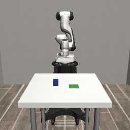 | 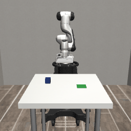 | 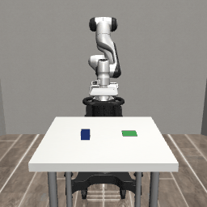 |

In the two messy_5 failures the cube lands on the target, then gets knocked over as the gripper lifts away. The
contact fixes send the gripper straight up after letting go, but the fingers start rising while they're still
opening, and after that short lift the path goes back to my recorded retreat, which stays close to the cube.
Waiting until the fingers are open, and keeping clearance above the target after the release as well as before,
would fix it. I didn't apply that, so that all results come from the same pipeline.

### My predictions before each experiment

| Prediction | What happened |
|---|---|
| Raw replay under 50% on random scenes | 4% |
| Object-relative over 70% | 100% |
| Raw replay grabs thin air when the cube has moved | 44/50 never lifted the cube |
| Object-relative struggles near the edge of reach | No failures up to ±25 × ±20 cm |
| A rotated cube would be gripped badly | Not tested: the cube's orientation is fixed in sim |
| BC policy around 100% | Single seeds 84.7% ± 15.2%; three averaged 100% |
| Under a nudge, open-loop replay recovers | 0/50: it goes to where the cube was |
| The re-planner beats the policy under a nudge | Tie, 50/50 each |
| BC fails through compounding errors | It hovers above the cube instead, and never fails after lifting |
| Closing at the cube shrinks the spread across seeds | The spread grew (80.7% ± 24.6%); averaging the seeds fixed it |
| Messy demos produce some failures | messy_4 100%, messy_5 96% |
| A 10 cm nudge separates the re-planner from the policy | Barely: 100% vs 98% |

## What didn't work

- **Calibrating with the board in my hand:** 1.3–1.6 px over three videos, and an unstable focal length. A flat
  board on the table fixed it (0.46 px).
- **Detecting when my hand was still, frame by frame:** it found no holds at all, because MediaPipe's landmarks
  jitter about 3 px per frame even when the hand doesn't move. A test over a short window works.
- **Shadows:** my hand's shadow made the cube look smaller, which an early version read as the cube moving. When
  a lift and a shadow happen together, the two size changes cancel out.
- **One depth scale per demo:** the release came out up to 7.9 cm off. Two anchors fixed it.
- **Depth blow-ups:** when MediaPipe put the wrist almost on top of the knuckle, the depth estimate jumped to
  −148 cm in one clip. Those points are now rejected.
- **Pausing the robot while its fingers close:** it caused failures, because the robot lags its target by 2–3 cm,
  so it stopped above the cube.
- **Lighting:** in my first batch of clean demos the light dimmed and the marker was lost in 55–91% of frames.
  I re-recorded them.
- **Single BC policies:** 46% to 100% from identical data. Fixing the gripper labels didn't help; averaging three
  seeds did.
- **Two demos fail at their recorded positions:** clean_8 (the tracked grasp point is 5 cm off the cube's centre)
  and clean_1 (the longest carry).
- **The depth check:** my wrist was out of frame in the table hold, and I didn't record any tilted holds.

## Limitations

- Depth from one camera depends on how the hand is held, and needs a known height in every demo (here, the
  cube's centre at the grasp and release).
- Position only: the grasp is top-down and the cube's orientation is fixed. The rotation clip shows the pipeline
  reproduces where the cube went, not how it was turned.
- In sim the object positions are exact. The error budget says about 1 cm of error is fine, but I didn't check
  how accurately a camera would find the cube.
- One task, one robot, and only in simulation, where contact is more forgiving than reality.

## VLAs and world models

I didn't train a VLA or a world model. My question was whether one phone video can be turned into robot data that
works, and the simplest learner, a small MLP on object positions, answers it. But the pipeline produces what a VLA
needs: every generated rollout can be rendered from the sim cameras, so one recorded demo becomes hundreds of
image-and-action episodes of the same task, the kind of dataset SmolVLA is fine-tuned on. The same rollouts with
their camera frames would also be training data for an action-conditioned video model.

## Next steps

- Harder disturbances that could separate the policy from the re-planner (later or repeated nudges, knocking the
  cube out of the gripper), and action chunking.
- A policy that works from images instead of exact object positions.
- Orientation: full pose transforms, using the cube's measured yaw.
- Fine-tuning a VLA such as SmolVLA on the generated rollouts.

## Related work

- **MimicGen:** generates many robot demos from a few teleoperated ones by transforming object-centric segments;
  built on robosuite. I use the same idea, starting from a human video instead of teleoperation.
- **DemoGen:** generates many synthetic demonstrations from one.
- **Phantom:** trains robot policies from human videos, using an RGB-D camera.

The difference here is the source: one phone video of my hand, no robot involved in collecting it and no depth
camera, so depth and the timing of the grasp have to come from the video itself.

## How this was built

I have used Claude as a pair-programmer for the code review and restructuring. The approach, the recordings, every experiment, its predictions and the analysis are mine, and I can explain every line.

## How to run everything

```bash
python3.12 -m venv .venv && source .venv/bin/activate
pip install -r requirements.txt

# MediaPipe hand model
curl -L -o models/hand_landmarker.task \
  https://storage.googleapis.com/mediapipe-models/hand_landmarker/hand_landmarker/float16/latest/hand_landmarker.task

# Perception (needs the videos in data/raw/)
python scripts/calibrate_camera.py data/raw/calib.mp4
python scripts/extract_2d.py data/raw/clean_*.mp4
python scripts/detect_events.py
python scripts/build_trajectory.py clean_12
python scripts/make_side_by_side.py clean_12

# Simulation
python scripts/replay_in_sim.py clean_12
python scripts/evaluate_generalisation.py clean_12
python scripts/evaluate_generalisation.py clean_12 --position-noise 0 0.5 1 1.5 2 3 4 5 --mark 0.3
python scripts/plot_success_map.py outputs/eval/clean_12_raw.json

# Behaviour cloning and the nudge experiment
python scripts/generate_dataset.py clean_12
python scripts/train_bc.py clean_12
python scripts/evaluate_policy.py clean_12
python scripts/evaluate_policy.py clean_12 --ensemble
python scripts/evaluate_nudge.py clean_12

# Every failure across all experiments, and a GIF of any one scene
python scripts/failure_summary.py
python scripts/render_failure.py bc_seed 2 --bc-seed 0
```

The physical measurements (marker, target, cube, hand) are in `src/measurements.py`.

## Repository structure

```
src/
  measurements.py           sizes of the real setup
  perception/geometry.py    marker pose, pixel rays, ray–plane intersection, hand-length depth
  sim/cube_env.py           robosuite scene (Panda, cube, target)
  sim/replay.py             demo to sim, contact fixes, one episode
  sim/generator.py          object-relative generation, random scenes
  policy/features.py        what the policy sees (used for both data collection and evaluation)
  policy/collect.py         expert data collection with noise
  policy/model.py           BC policy (MLP with a movement head and a gripper head)
scripts/                    the pipeline steps above, plus checks and analysis
data/calib/                 camera calibration
data/processed/             per-frame detections, events, trajectories, BC dataset
models/                     trained BC policies
docs/media/                 the figures in this README
outputs/                    per-scene results (JSON)
```

## Environment notes

Python 3.12, PyTorch (CPU), robosuite 1.5.2, MuJoCo pinned to 3.3.7 (3.10 and later break robosuite 1.5.2),
MediaPipe 1.1.0 (Tasks API), and only `opencv-contrib-python==4.11.0.86` (robosuite and MediaPipe each install a
different OpenCV package; keep just one).